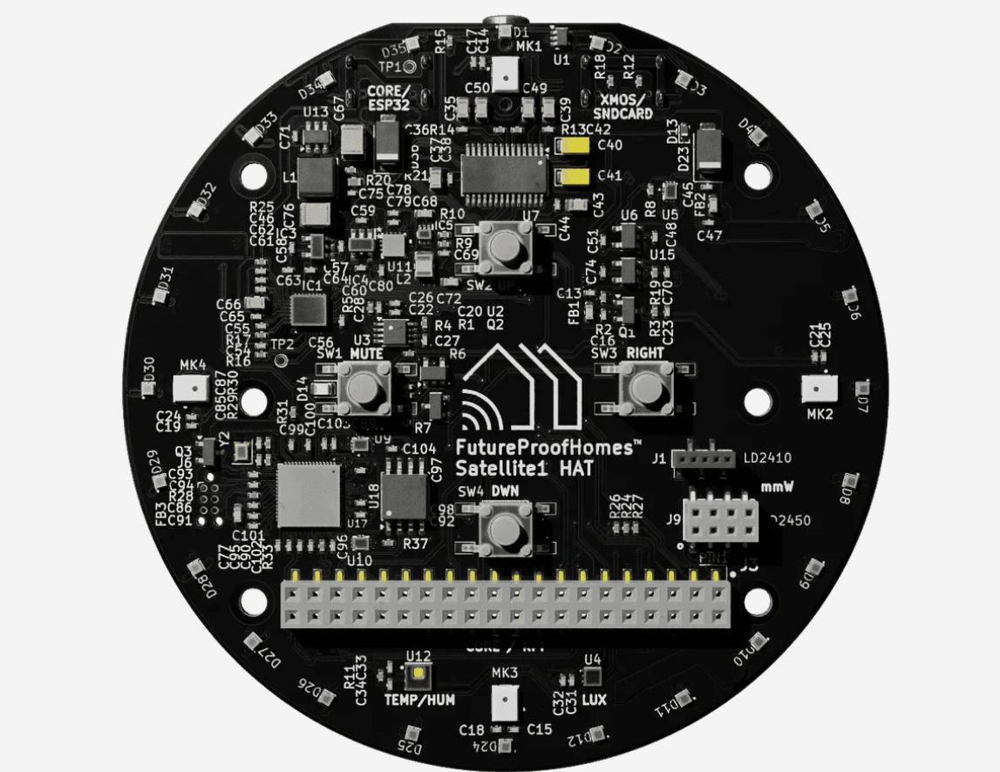
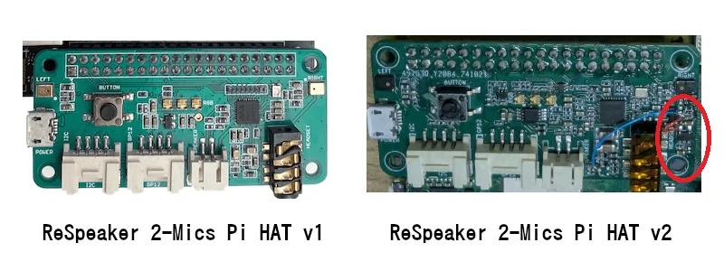
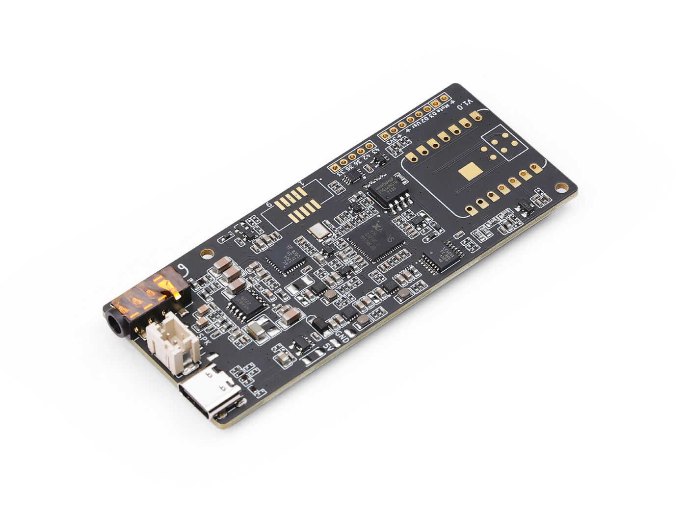

# PiCompose

[](https://github.com/florian-asche/PiCompose/actions/workflows/build-all.yml) [](https://github.com/florian-asche/PiCompose/releases) [](https://github.com/florian-asche/PiCompose/blob/main/LICENSE) [](https://github.com/florian-asche/PiCompose/commits)

Ready-to-use Raspberry Pi OS images that start your Docker Compose projects on their own, such as the [linux-voice-assistant](https://github.com/OHF-Voice/linux-voice-assistant) for Home Assistant, [docker-snapcast](https://github.com/florian-asche/docker-snapcast), [Music Assistants Snapcast](https://github.com/music-assistant/local-audio-addon) or the [bt-proxy](https://github.com/denvera/bt-proxy) Bluetooth proxy. Flash the SD card, put it into your Raspberry Pi and start.

PiCompose builds on the official Raspberry Pi OS and adds everything a voice satellite needs: the audio drivers of the supported voice hardware, the PipeWire audio server, Docker and a small manager that deploys your projects at boot and keeps them up to date. There is no manual setup. Write the image to an SD card, set your Wi-Fi in the Raspberry Pi Imager, put the card into the Raspberry Pi and power it on.

Prebuilt images exist for the Satellite1, the ReSpeaker 2-Mic HAT v1 and v2.0, the ReSpeaker Lite and for other hardware. The images with Linux-Voice-Assistant in their name come ready for Home Assistant, with the Linux-Voice-Assistant, Snapcast, Music Assistant Local Audio and the Bluetooth proxy already prepared.


## Features

- Automated build of a customized Raspberry Pi OS image using GitHub Actions
- Prebuilt images with drivers for the supported voice hardware (2-Mic HAT v1/v2, ReSpeaker Lite, Satellite1). The drivers are installed as packages from the APT repository
- No manual configuration of the Raspberry Pi required
- Docker and Docker Compose are installed
- Each Docker Compose project found in a special directory on the main partition (compose directory) is deployed automatically, and your own projects are easy to add
- Configurable regular re-deployments on boot or via Crontab with a simple configuration file
- Image prepared for audio usage: the PipeWire audio server is started and the system audio volume is set to 100% (one time)
- The Keep-Audio-Alive service is started if you use the ReSpeaker Lite
- The hostname is generated automatically as `picompose-<mac-address>` (the MAC address without colons), unless you changed it with the Imager beforehand
- SSH is enabled for the user `pi`
- The [PiCompose APT repository](https://github.com/florian-asche/PiCompose-Repository) is set up on the device (package `picompose-archive-keyring`, suite `trixie`), so packages of the PiCompose project can be installed with `apt` and the signing key is updated through `apt upgrade`
- The compose manager, the hostname service and the PipeWire configuration files come from the package `picompose-core` of the [PiCompose APT repository](https://github.com/florian-asche/PiCompose-Repository), so `apt upgrade` updates them
- The device updates itself (unattended-upgrades) and its software. No more reflashing.
- The images with `_Linux-Voice-Assistant` in their name also contain these projects in the project directory. They come from the package `picompose-software-ha-satellite` of the [PiCompose APT repository](https://github.com/florian-asche/PiCompose-Repository). The default ports are in square brackets:
  - [linux-voice-assistant](https://github.com/OHF-Voice/linux-voice-assistant) - A remote voice satellite implementation using the ESPHome protocol, pre-configured for Home Assistant [6053 API, 6055 peripheral WebSocket API]
  - [docker-snapcast](https://github.com/florian-asche/docker-snapcast) - A Docker image for Snapcast server and client, providing multi-room audio streaming capabilities. Only the client is used, it is disabled by default [no port, the client connects to your Snapcast server]
  - [local-audio-addon](https://github.com/music-assistant/local-audio-addon) - Music Assistant Local Audio, a Sendspin player for Music Assistant [8928]
  - [bt-proxy](https://github.com/denvera/bt-proxy) - An ESPHome-compatible Bluetooth proxy for Home Assistant [6054]

## Requirements

- A 64-bit Raspberry Pi. The hardware pages name the Raspberry Pi Zero 2 W(H), 3 B / 3 B+ and 4 B, other models are not documented here
- An SD card
- A network connection with internet access, because the containers are downloaded on the first start
- A supported audio hardware (see [Hardware](#hardware-and-images)), or other audio hardware with the base image
- [Home Assistant voice components](https://www.home-assistant.io/voice_control/), if you use the Linux-Voice-Assistant
- Optional: the [Raspberry Pi Imager tool](https://www.raspberrypi.com/documentation/computers/getting-started.html#imager-install) to write the image and set Wi-Fi and SSH before the first boot

## Usage

### Hardware and images

Click the name of a hardware to open its page. Every hardware has two images, one without and one with `_Linux-Voice-Assistant` in its name. What they contain is described in [Features](#features).

| Hardware | Images | Driver and extras |
| -------- | ------ | ----------------- |
| **[Satellite1](docs/hardware_sattelite1.md)**<br> | `PiCompose_Satellite1-v1.0`<br>`PiCompose_Satellite1-v1.0_Linux-Voice-Assistant` | Satellite1 HAT driver |
| **[ReSpeaker 2-Mic HAT v1](docs/hardware_2mic_v1.md)**<br> | `PiCompose-2MicHat-v1`<br>`PiCompose_2MicHat-v1_Linux-Voice-Assistant` | Seeed voicecard driver (device-tree overlay) |
| **[ReSpeaker 2-Mic HAT v2.0](docs/hardware_2mic_v2.md)**<br> | `PiCompose-2MicHat-v2`<br>`PiCompose_2MicHat-v2_Linux-Voice-Assistant` | Seeed voicecard driver |
| **[ReSpeaker Lite](docs/hardware_respeaker_lite.md)**<br> | `PiCompose-Respeaker_lite`<br>`PiCompose_Respeaker_lite_Linux-Voice-Assistant` | Audio keep-alive service, workaround for connectivity issues in combination with the Pi Zero 2W |
| **Other hardware** | `PiCompose`<br>`PiCompose_Linux-Voice-Assistant` | No driver |

### Installation

#### With the Raspberry Pi Imager

Write the image to your SD card with the [Raspberry Pi Imager tool](https://www.raspberrypi.com/documentation/computers/getting-started.html#imager-install). Windows, macOS, and Linux are supported. On macOS, you can use the Raspberry Pi Imager application or install it via Homebrew.

1. Add the PiCompose image repository. Without it you cannot change the settings (wifi credentials, ssh public keys and others) in the `Raspberry Pi Imager >= v2.0`. Start the Imager with the repository:

   Windows

   ```sh
   "C:\Program Files\Raspberry Pi Ltd\Imager\rpi-imager.exe" --repo https://github.com/florian-asche/PiCompose/releases/download/rpi-imager-json/rpi-imager.json
   ```

   Linux and macOS

   ```sh
   rpi-imager --repo https://github.com/florian-asche/PiCompose/releases/download/rpi-imager-json/rpi-imager.json
   ```

   Or put the [URL](https://github.com/florian-asche/PiCompose/releases/download/rpi-imager-json/rpi-imager.json) in Settings - Image Repository - Use own URL.
2. Choose your image. The repository groups the images into `PiCompose - stable`, `PiCompose - other versions`, `PiCompose - development` and `PiCompose - branches`. Use `stable` unless you want to test something.
3. Set wifi credentials, ssh public keys and other settings in the customisation part of the Imager before you write the image.
   💡 **Note:** In the "Customisation" (sic) part of the Imager, the "User" must be set to "pi".
4. Write the image to the SD card.

#### Without the Raspberry Pi Imager

[Download](https://github.com/florian-asche/PiCompose/releases) the image and write it to the SD card with a tool of your choice. Configure keyboard, timezone and wifi credentials with the [`raspi-config` tool](https://www.raspberrypi.com/documentation/computers/configuration.html#raspi-config). You need to connect a monitor, keyboard, and mouse to access the Pi initially to configure SSH and WiFi via `raspi-config`.

### Configuration

You can customize the PiCompose configuration in the `/compose` directory on the root filesystem. You can change how it is updated, how it is handling a reboot and you can remove `snapcast`, `local-audio` or `bt-proxy` if you dont want to use them. The `docker-compose.yml` of `lva`, `snapcast`, `local-audio` and `bt-proxy` belongs to the package and is replaced when the package is upgraded, so change `picompose.conf` and `.env` instead.

You can also add your own docker-compose projects to the system:

1. Create directories for your Docker Compose projects in the `compose` folder on the main partition.
2. Place your `docker-compose.yml` files and associated configurations like `.env` in the appropriate subdirectories (see the `example` directory)
3. Configure the `picompose.conf` file to include your projects.

#### Configurationfile

The configuration file is named `picompose.conf` and is located in specific application directories.

```ini
# Disable this deployment
DISABLED=false

# Configure if piCompose should run on boot
# When it runs without image pull, it does a docker compose down and up.
BOOT_ENABLED=false

# Configure if piCompose should update the docker image on boot
# BOOT_ENABLED needs to be true
BOOT_IMAGE_PULL=false

# Configure if piCompose should run periodically via cron
# When it runs without image pull, it does a docker compose down and up.
CRON_ENABLED=true

# Cron schedule for automatic re-deployments
# Format: Minute Hour Day Month Weekday
# Examples:
# "0 4 * * *"     - Every day at 4 AM
# "0 */6 * * *"   - Every 6 hours
# "0 0 * * 0"     - Every Sunday at midnight
CRON_SCHEDULE="0 4 * * *"

# Configure if piCompose should update the docker image on cron run
# CRON_ENABLED needs to be true
CRON_IMAGE_PULL=true
```

### First start

1. Make sure that you configured your wifi credentials before the first boot. You can do this with the Raspberry Pi Imager when writing the image to your SD card.
2. On the first boot the system creates new SSH host keys. If you have a monitor connected, you can see that. The system then reboots automatically.
3. PiCompose downloads and installs the containers. This can take some time, because the images come from the internet. You can follow the progress in the logfile `/var/log/picompose.log`.
4. The Linux-Voice-Assistant and the Local Audio Addon (Sendspin) then show up in the Home Assistant discovery.

You can log in with the user `pi` if needed. If you did not change the password with the Imager, it is `raspberry`, so change it.

Snapcast is disabled by default, `lva`, `local-audio` and `bt-proxy` are enabled. You can change that in the `picompose.conf` of the project and reboot.

## Build information

PiCompose uses the official [pi-gen](https://github.com/RPi-Distro/pi-gen) tool from Raspberry Pi to create a customized Raspberry Pi OS image. GitHub Actions build every image variant and attach it to a GitHub release. A generated `rpi-imager.json` makes the images selectable in the Raspberry Pi Imager. See [DEVELOPMENT.md](DEVELOPMENT.md) for details.

## Development

See [DEVELOPMENT.md](DEVELOPMENT.md) for information on the development and build process.

## License

This project is released under the [BSD-3-Clause License](LICENSE).
