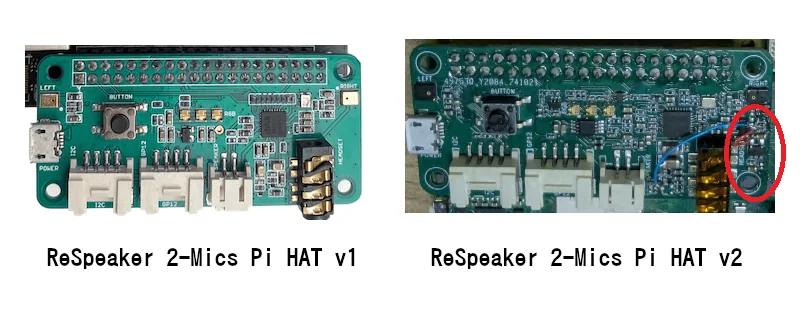

# Hardware - ReSpeaker 2-Mics Pi HAT v1

</img>

Features:
- Two microphones (Mic L and Mic R)
- Two Grove connectors
- One User-defined button
- 3.5mm audio interface
- XH2.54-2P audio output interface

## Order

### Base:

- Raspberry Pi Zero 2 WH (currently no link) or if you can solder the pins yourself [Raspberry Pi Zero 2 W](https://amzn.to/3M0G4hC)
- [SD-Card](https://amzn.to/4qfx06l)
- [US MicroUSB Power Supply](https://amzn.to/4c52mt3)

### ReSpeaker 2-Mics Pi HAT v1

- [ReSpeaker 2Mic HAT](https://wiki.keyestudio.com/Ks0314_keyestudio_ReSpeaker_2-Mic_Pi_HAT_V1.0)
- [Cable for Speaker](https://amzn.to/3ZvU0Dz)

## Technical notes

The v1 has a WM8960 codec (I2C `0x1a`). The Raspberry Pi OS kernel already has its driver (`snd-soc-wm8960`), so no kernel module is built. The image only needs:

1. The device-tree overlay `respeaker-2mic-v1_0.dtbo` (built from [Seeed-Studio/seeed-linux-dtoverlays](https://github.com/Seeed-Studio/seeed-linux-dtoverlays)), enabled via `dtoverlay=respeaker-2mic-v1_0` in `/boot/firmware/config.txt`. It names the card `seeed2micvoicec`.
2. `dtparam=i2c_arm=on` and `dtparam=spi=on` (SPI is for the LEDs of the HAT) in `/boot/firmware/config.txt`.
3. Volume: the WM8960 starts with `Headphone` at 0 (-121 dB), which is nearly silent.

The PiCompose `02-stage-audiodriver-2michat-v1` stage installs the package `picompose-driver-2michat-v1` from the APT repository ([PiCompose-Package-Driver-2MicHat-V1](https://github.com/florian-asche/PiCompose-Package-Driver-2MicHat-V1)), which does the first two steps. For step 3 the package ships an ACP profile set for the sound card, selected by a udev rule. It merges `Headphone` and `Speaker` into the volume of the PipeWire sink and sets the digital volume `Playback` to 0 dB, so the default volume of 100 % (`51-default-volume.conf` of `picompose-core`) puts both outputs at their maximum (+6 dB), and a lower sink volume lowers them. Checked on one device after a reboot with the package 1.0.2: the controls follow the sink volume. How loud the card is has not been checked for every case.

The 4-Mics and 6-Mics HATs have an AC108 codec, which the kernel does not have. They are not supported by this stage any more.

## Additional information:

- [Wiki](https://github.com/Seeed-Studio/wiki-documents/blob/docusaurus-version/docs/Sensor/ReSpeaker_2-Mics_Pi_HAT/v1-deprecated/ReSpeaker_2_Mics_Pi_HAT_Raspberry.md)
- [seeed-linux-dtoverlays (overlay source)](https://github.com/Seeed-Studio/seeed-linux-dtoverlays)
- [Keyestudio documentation](https://docs.keyestudio.com/projects/KS0314/en/latest/docs/KS0314.html#overview)
