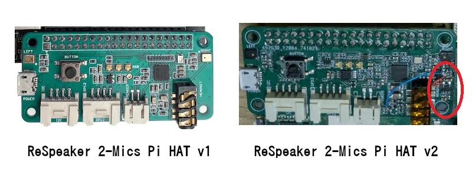

# Hardware - ReSpeaker 2-Mics Pi HAT v2.0

</img>

The V2.0 is a silent hardware revision of the 2-Mics Pi HAT. Visually identical, electrically different: the WM8960 codec used on v1 (I2C `0x1a`) is replaced with a **TLV320AIC3104** codec (I2C `0x18`). This matters because the v1 driver stage does not produce a working sound card on v2 hardware, and because the mixer defaults differ.

Features (same as v1):
- Support the Raspberry Pi 3B / 4B / Zero 2 W
- Two microphones (Mic L and Mic R)
- Two Grove connectors
- One User-defined button
- 3.5 mm audio interface
- XH2.54-2P audio output interface

## Order

### Base:

- [Raspberry Pi Zero 2 W](https://amzn.to/3M0G4hC)
- [SD-Card](https://amzn.to/4qfx06l)
- [US MicroUSB Power Supply](https://amzn.to/4c52mt3)
- [Cable for Speaker](https://amzn.to/3ZvU0Dz)

### ReSpeaker 2-Mics Pi HAT v2.0

- [Seeed Studio ReSpeaker 2-Mics Pi HAT V2.0](https://wiki.seeedstudio.com/respeaker_2_mics_pi_hat_v2/)

## Technical notes

Unlike v1 — which needs an out-of-tree DKMS kernel module — v2 uses the mainline `snd-soc-tlv320aic3x` driver that already ships with the Raspberry Pi OS kernel. The image only needs:

1. The device-tree overlay `respeaker-2mic-v2_0.dtbo` (built from [Seeed-Studio/seeed-linux-dtoverlays](https://github.com/Seeed-Studio/seeed-linux-dtoverlays)), enabled via `dtoverlay=respeaker-2mic-v2_0` in `/boot/firmware/config.txt`.
2. `dtparam=i2c_arm=on` in `/boot/firmware/config.txt`.
3. Mixer tuning — the TLV320 ships with several attenuators well below 100 % (`HP DAC` at -23.5 dB in particular), producing a card that appears to work but is inaudible at typical application volumes.

The PiCompose `02-stage-audiodriver-2michat-v2` stage installs the package `picompose-driver-2michat-v2` from the APT repository ([PiCompose-Package-Driver-2MicHat-V2](https://github.com/florian-asche/PiCompose-Package-Driver-2MicHat-V2)), which does the first two steps. The package also does the mixer tuning of step 3. `configure_audio.service` is gone. Instead the package (version 0.2.0 and later) ships an ACP profile set for the sound card, selected by a udev rule. It merges `HP DAC` and `Line DAC` into the volume of the PipeWire sink, so the default volume of 100 % (`51-default-volume.conf` of `picompose-core`) puts both at 0 dB, and a lower sink volume lowers `HP DAC`. Checked on one device after a reboot: both controls at 100 %, and the sink volume changes `HP DAC`. How loud the card is has not been checked, and the other controls (`HP`, `HPCOM DAC`, the input gain `PGA`) are left as the codec starts. Raise them with `amixer` or `alsamixer` if you need more.

## Additional information

- [Seeed Studio Wiki — ReSpeaker 2-Mics Pi HAT v2.0](https://wiki.seeedstudio.com/respeaker_2_mics_pi_hat_v2/)
- [seeed-linux-dtoverlays (overlay source)](https://github.com/Seeed-Studio/seeed-linux-dtoverlays)
